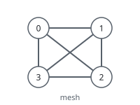
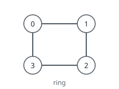
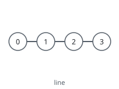
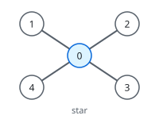
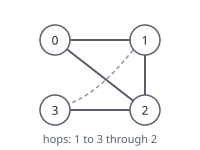
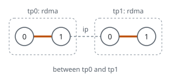
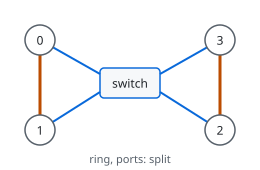
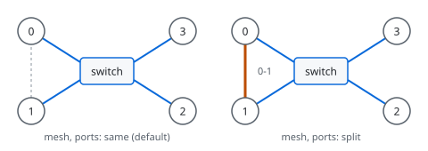

# mentat

mentat is a self-organizing cluster manager for a small number of nodes. It
provides a standalone cluster or replaces an existing one such as Ray with a
lighter manager.

Its components:

 - a daemon that places actors and watches their liveness
 - an HTTP/MCP router that puts one OpenAI-compatible endpoint in front of
   every model
 - a pure-Python package that installs as `ray` and implements the surface
   vLLM's Ray executor uses

mentat builds the cluster with no configuration. Registration retries
forever, so daemons and containers start in any order. UDP locates peers, or
`MENTAT_PEERS` bootstraps the mesh. Containers use the local daemon's
address. All binaries are static executables.

## Ray compatibility

mentat omits most of Ray. There is no object store, memory monitor, raylet
or dashboard. Per-token work is unchanged. vLLM's workers exchange data over
its own MessageQueue and NCCL, and after boot the only recurring Ray call is
`ray.wait` every 5 seconds.

## Components

| Component | Source | Description | Overhead |
| --- | --- | --- | --- |
| `mentatd` | [rust/mentatd/](rust/mentatd/), [crates.io](https://crates.io/crates/mentatd) | Daemon, agent and CLI in one binary | 1.7 MiB on disk, ~2.5 MiB RSS |
| `mentatd-serve` | [rust/mentatd-serve/](rust/mentatd-serve/), [crates.io](https://crates.io/crates/mentatd-serve) | Router, its own crate and container | 1.7 MiB on disk, ~3.2 MiB RSS |
| `mentat-claim` | [rust/claim/](rust/claim/) | The claim solver, as a library and a JSON command-line tool | |
| `mentat-common` | [rust/common/](rust/common/) | Announcement signing and logging, shared by both binaries | |
| `ray` shim | [python/](python/) | Pure-Python package claiming the `ray` import name | ~2 MiB in a running interpreter |

## Ports

| Port | Owner | Purpose |
| --- | --- | --- |
| 6379/tcp | `mentatd` | Control. The port `RAY_ADDRESS` specifies |
| 6380/tcp | `mentatd` | HTTP: `/status`, `/metrics`, `/events` |
| 6381/tcp | `mentatd-serve` | HTTP: `/v1`, `/mcp`, `/status.json` |
| 6382/udp | both | Daemon announcements |

## Installation

From source:

```
cargo install mentatd mentatd-serve
pip wheel --no-deps -w dist ./python
```

The wheel is not on PyPI. The published artifacts image has the binaries
and the wheel:

```
docker pull ghcr.io/kindlingai/mentat-artifacts:0.26.0
```

Each published image covers linux/amd64 and linux/arm64. Docker Hub has
the same images as `mmastrac/<image>`, such as
`mmastrac/mentat-artifacts:0.26.0`. Each
[GitHub release](https://github.com/kindlingai/mentat/releases) also carries
the static binaries, the wheel and their SHA256SUMS.

Building every image locally:

```
VERSION=0.26.0 ./build.sh
```

This produces `mentat-artifacts:<ver>` (both binaries and the wheel, for
`COPY --from`), `mentatd:<ver>`, `mentatd-serve:<ver>` and `mentat:<ver>`
(both binaries in one image).

## Quick start

A daemon runs on each node, on the host network:

```
MENTAT_NODE_IP=10.0.0.1 MENTAT_PEERS=10.0.0.2:6379 mentatd daemon
```

The model image replaces Ray with the shim:

```dockerfile
COPY --from=ghcr.io/kindlingai/mentat-artifacts:0.26.0 /out/mentatd /usr/local/bin/mentatd
COPY --from=ghcr.io/kindlingai/mentat-artifacts:0.26.0 /out/mentatd-0.26.0-py3-none-any.whl /tmp/
RUN ln -s /usr/local/bin/mentatd /usr/local/bin/ray \
 && pip uninstall -y ray \
 && pip install --no-deps /tmp/mentatd-0.26.0-py3-none-any.whl
```

The entrypoint exports the group before `ray start`. The daemon on the box
relays to the head, so no address is needed:

```bash
export VLLM_USE_RAY_V2_EXECUTOR_BACKEND=1
export MENTAT_GROUP=mymodel
ray start
vllm serve ... --distributed-executor-backend ray -tp 2
```

Cluster state, from any node:

```
mentatd status
```

[mentatd.yaml](mentatd.yaml) and [mentatd-serve.yaml](mentatd-serve.yaml)
are compose files for the daemon and the router. Both need `network_mode:
host`.

## Claims

A claim reserves nodes and links under a name. The head solves the claim
once. Each holder gets the same view. Set `MENTAT_CLAIM` and
`MENTAT_CLAIM_SHAPE` for vLLM, or send `claim` ([PROTOCOL.md](PROTOCOL.md)).
The [mentat-claim](rust/claim/) crate runs the same solver without a daemon.

```json
{"sets": [{"name": "tp", "bundles": 4, "link": "rdma", "layout": "ring"}]}
```

### Layouts

| Layout | Rule | |
| --- | --- | --- |
| `mesh` | Each member links to each other member. This is the default. |  |
| `ring` | Each member links to the next member. The last member links to the first. |  |
| `line` | Each member links to the next member. |  |
| `star` | The hub links to each leaf. The hub is member 0. |  |
| `any` | The first fit of mesh, ring, star and line. Then `hops`: each member reaches each other member directly or through one member. `layouts` in the view gives the result. |  |

### Set options

| Option | Values | Default | Effect |
| --- | --- | --- | --- |
| `name` | text | | Names the set in the view. |
| `bundles` | count, or GPUs per node | | One member per node. A count gives 1 GPU per member. |
| `link` | `rdma`, `ip` | `ip` | `rdma` uses only ports tagged `rdma`. |
| `layout` | above | `mesh` | |
| `ports` | `auto`, `split`, `same` | `auto` | See "Ports". A star refuses it. |
| `max_hops` | `1` | `1` | For `any` only. |
| `vendor` | GPU vendor | first fit | Puts the set on one vendor. |

### Shape options

| Option | Values | Default | Effect |
| --- | --- | --- | --- |
| `between` | `{from, to, link}` | none | Needs a link of `link` between two sets. |
| `driver` | `first`, `ignore` | `first` | `first` puts rank 0 on the claimant's node. vLLM needs this. `ignore` keeps the solved order. |



### Ports

A port is one address group on a node. Two addresses on one wire are one
port. Each PCIe root is a separate port.

Ring and line:

| `ports` | Each member reaches its two neighbours |
| --- | --- |
| `auto` | On different ports if possible, else on the best links |
| `split` | On different ports, or the claim fails |
| `same` | On one port, or the claim fails |



Mesh:

| `ports` | Effect |
| --- | --- |
| `same` (and `auto`) | Each member uses one port for all members. An `rdma` set stays in one island, usually the switch. |
| `split` | Each pair spreads its traffic over all its direct links. A cable carries its pair's traffic before the switch. The solver picks the nodes with the least load on the busiest port. Each link in `links` gets a `share`. At most 64 members. |



## Documentation

- [GUIDE.md](GUIDE.md): the `mentatd` manual. Commands, environment,
  migration from Ray, fabrics, HTTP interface.
- [GUIDE-SERVE.md](GUIDE-SERVE.md): the `mentatd-serve` manual. Endpoint
  announcement, routing, environment, HTTP interface.
- [PROTOCOL.md](PROTOCOL.md): the wire protocol.
- [tests/README.md](tests/README.md): the test suites. None need a GPU.
